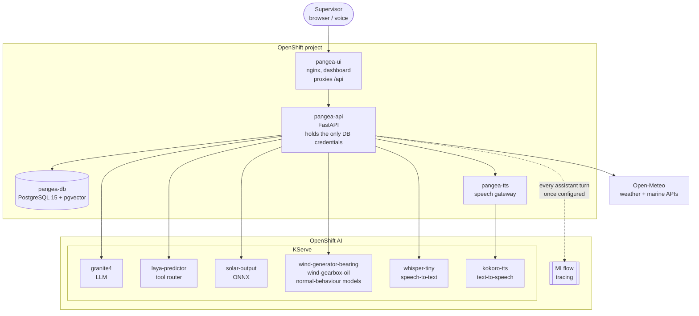

# Predict and schedule renewable energy fleet maintenance with AI

Deploy an AI operations platform for wind, solar and wave sites: output forecasting, live shutdown alerts, and a voice assistant for maintenance scheduling.

## Table of Contents

- [Overview](#overview)
- [Detailed description](#detailed-description)
  - [See it in action](#see-it-in-action)
  - [Architecture diagrams](#architecture-diagrams)
- [Requirements](#requirements)
  - [Minimum hardware requirements](#minimum-hardware-requirements)
  - [Minimum software requirements](#minimum-software-requirements)
  - [Required user permissions](#required-user-permissions)
- [Deploy](#deploy)
  - [Prerequisites](#prerequisites)
  - [Installation](#installation)
  - [Validating the deployment](#validating-the-deployment)
  - [Enabling MLflow tracing](#enabling-mlflow-tracing)
  - [Delete](#delete)
- [Repository structure](#repository-structure)
- [References](#references)
- [Technical details](#technical-details)
- [Tags](#tags)

## Overview

Renewable energy operators run assets that are remote, weather-dependent and
expensive to visit. A supervisor has to know which sites are producing, which
are shut down, which turbines are about to fail, and which engineer is both
qualified and on shift to fix them — usually across several disconnected
systems.

This quickstart deploys a single operations platform that answers those
questions. It forecasts output for solar and wave sites, shuts wind sites down
when the wind exceeds safe limits, tracks work orders against an engineer
roster, and puts a conversational assistant in front of all of it that
supervisors can talk to by voice or text.


## Detailed description


The platform brings information together behind one API and one dashboard. Live
weather drives an output forecast per site, so a supervisor can see predicted
generation against what the fleet is actually producing and spot the gap.
Wind speed above the cut-out threshold automatically marks sites as shut down
and raises an alert, so nobody is dispatched into a storm. Work orders carry
the certifications and weather conditions they require, and the roster knows
who is on shift, who is on leave and who is already fully loaded.

On top of that sits the assistant, Pangea. A supervisor can ask "which sites are down?"
or "who can take the yaw drive fault at Blavand this week?" and get an answer
grounded in current fleet data rather than a generic model response. A tool
router decides which fleet data each question needs, so the language model
answers from real records. Because control-room staff often have their hands
busy, the assistant also accepts speech and answers aloud.

The fleet in this quickstart is fictional — eleven European sites and 104
turbines of synthetic data.

| Technology | Sites |
|------------|-------|
| Wind | Calanda, Blavand, Odra, Sintra, Tabernas, Björnefjäll |
| Solar | Guadalquivir, Alentejo, Trinacria |
| Wave | Orkney, Runde |

### See it in action

> **CONTRIBUTOR TODO: add demo links**
>
> Add an Arcade interactive demo or a short video walkthrough here. Many
> reviewers will not have a cluster to hand, so this is worth adding before
> submitting for publication.

### Architecture diagrams



The browser talks only to `pangea-ui`, which reverse-proxies `/api` to the
backend on the same origin. That means no CORS configuration and no externally
reachable route for the API. `pangea-api` is the only component that holds
database credentials, which it reads from the `pangea-db-credentials` Secret.


## Requirements

### Minimum hardware requirements


**Application:**

| Component | CPU (request / limit) | Memory (request / limit) |
|-----------|-----------------------|--------------------------|
| `pangea-db` | 250m / 2 | 512Mi / 2Gi |
| `pangea-api` | 50m / 500m | 128Mi / 512Mi |
| `pangea-ui` | 20m / 200m | 32Mi / 128Mi |
| `pangea-tts` | 500m / 1 | 512Mi / 1Gi |

**Models:**

| Model | Serves | CPU (request / limit) | Memory (request / limit) |
|-------|--------|-----------------------|--------------------------|
| `granite4` | assistant LLM, vLLM | 2 / 6 | 8Gi / 18Gi |
| `whisper-tiny` | speech-to-text, vLLM | 2 / 4 | 8Gi / 24Gi |
| `laya-predictor` | tool router | 2 / 4 | 6Gi / 10Gi |
| `kokoro-tts` | text-to-speech | 1 / 4 | 2Gi / 4Gi |
| `solar-output` | solar forecast | 2 / 3 | 4Gi / 4Gi |
| `wind-generator-bearing` | predictive maintenance | 2 / 3 | 4Gi / 4Gi |
| `wind-gearbox-oil` | predictive maintenance | 2 / 3 | 4Gi / 4Gi |

**Total:** roughly **14 CPU and 37Gi of schedulable memory** in requests. All
seven models are deployed; the cluster has to be able to place them or the
model pods stay `Pending`.

**Storage:** 10Gi default for the database PVC, configurable with
`--set storageSize=`.

### Minimum software requirements

- Red Hat OpenShift
- Red Hat OpenShift AI 3.4
- `oc` CLI, authenticated against the cluster
- `helm` CLI, version 3


### Required user permissions

This quickstart can be deployed by any user with:

- Permission to create a project/namespace
- Permission to deploy applications via Helm and to run builds

The database runs under OpenShift's default `restricted-v2` SCC with a random
UID. One exception: the optional MLflow tracing creates a ServiceAccount bound
to the `admin` ClusterRole within the project.

## Deploy


### Installation

```bash
git clone https://github.com/rh-ai-quickstart/pangea-energy.git
cd pangea-energy
```

```bash
PROJECT=pangea-energy-and-power
oc new-project ${PROJECT}
oc label namespace ${PROJECT} opendatahub.io/dashboard=true
```

The label registers the project with the OpenShift AI dashboard. `oc
new-project` does not set it, and it only works on the namespace.

```bash
oc new-build --name pangea-api --binary --strategy=docker
oc patch bc/pangea-api --type=merge \
  -p '{"spec":{"strategy":{"dockerStrategy":{"dockerfilePath":"Containerfile"}}}}'
oc start-build pangea-api --from-dir=backend --follow
```

```bash
oc new-build --name pangea-ui --binary --strategy=docker
oc patch bc/pangea-ui --type=merge \
  -p '{"spec":{"strategy":{"dockerStrategy":{"dockerfilePath":"Containerfile"}}}}'
oc start-build pangea-ui --from-dir=frontend --follow
```


```bash
helm install pangea deploy --namespace ${PROJECT}
oc rollout status statefulset/pangea-db -n ${PROJECT}
oc rollout status deployment/pangea-api -n ${PROJECT}
```

39 objects: database, API, dashboard, and the serving manifests for all seven
models. The database applies its schema and demo fleet on first start, so the
StatefulSet takes a few minutes.

To set the database password instead of having one generated:

```bash
helm install pangea deploy -n ${PROJECT} --set pangea-db.credentials.password=<password>
```

### Validating the deployment

```bash
oc get pods -n ${PROJECT}
```

```bash
oc get isvc -n ${PROJECT}
```

```bash
oc exec deployment/pangea-api -n ${PROJECT} -- curl -s localhost:8080/api/health
```

```bash
oc exec statefulset/pangea-db -n ${PROJECT} -- \
  psql -U pangea_app -d pangea -c "SELECT status, count(*) FROM turbines GROUP BY status;"
```

```bash
oc exec deployment/pangea-api -n ${PROJECT} -- curl -s localhost:8080/api/agent/health
```

```bash
oc get route pangea-ui -n ${PROJECT} -o jsonpath='https://{.spec.host}{"\n"}'
```

All seven InferenceServices should read `READY=True`, and the dashboard opens
on the welcome screen followed by live turbine counts and an alert feed.

### Enabling MLflow tracing

Optional. Everything else works without it. When on, every assistant turn is
traced: the tool the router picked, the data it was given, the reply.

```bash
MLFLOW_URL=https://$(oc get route data-science-gateway -n openshift-ingress -o jsonpath='{.spec.host}')/mlflow
echo ${MLFLOW_URL}
```

MLflow is served under `/mlflow` on the RHOAI data science gateway. Check it
answers before configuring anything — this is the endpoint the MLflow client
probes on startup, so JSON here means the client will work:

```bash
TOKEN=$(oc create token pangea-mlflow -n ${PROJECT})
curl -skL -H "Authorization: Bearer ${TOKEN}" "${MLFLOW_URL}/api/3.0/mlflow/server-info"
```

```bash
oc set env deploy/pangea-api -n ${PROJECT} MLFLOW_TRACKING_URI=${MLFLOW_URL} MLFLOW_WORKSPACE=${PROJECT}
```

```bash
oc logs deploy/pangea-api -n ${PROJECT} | grep 'mlflow tracing'
```

Success:

```
INFO:pangea.tracing:mlflow tracing -> https://<host>/mlflow experiment=<project>
```


If tracing stays disabled, the warning names the cause. `No module named
'sqlparse'` and any message about `./mlruns` both mean `MLFLOW_TRACKING_URI`
is not a valid URL, so MLflow treated it as a local path — check with
`oc exec deploy/pangea-api -n ${PROJECT} -- printenv MLFLOW_TRACKING_URI`.

### Delete

```bash
helm uninstall pangea -n ${PROJECT}
oc delete pvc -l app.kubernetes.io/name=pangea-db -n ${PROJECT}
```

The PVC is kept by `helm uninstall` so it cannot destroy data; delete it
explicitly, or a reinstall will reuse the old database with its old password.

```bash
oc delete project ${PROJECT}
```

## Repository structure

```
.
├── deploy/                   # every Helm chart, one release for the whole stack
│   ├── Chart.yaml
│   ├── values.yaml           # no settings of its own; subchart overrides
│   ├── templates/            # the InferenceService / ServingRuntime manifests
│   │                         # for all seven models, plus the tts gateway
│   └── charts/
│       ├── pangea-db/        # schema and seed applied on first start
│       │   ├── files/init/   # extensions, types, tables, indexes, views,
│       │   │                 # rota and normal-behaviour SQL functions
│       │   └── files/seed/   # demo fleet: sites, turbines, readings, operations
│       ├── pangea-api/       # assistant persona ConfigMap, scoring CronJob
│       └── pangea-ui/        # Deployment, Service and Route in one file
├── database/                 # PostgreSQL 15 + pgvector notes
│   └── README.md
├── backend/                  # async FastAPI service
│   ├── app/
│   │   ├── main.py           # app, CORS, lifespan, router wiring
│   │   ├── config.py         # env-driven settings
│   │   ├── laya.py           # tool-router client and context slicing
│   │   ├── tracing.py        # optional MLflow tracing
│   │   └── routers/          # fleet, turbines, turbine_health, alerts, solar,
│   │                         # wave, wind, operators, shifts, maintenance,
│   │                         # actions, voice, agent
│   ├── Containerfile         # UBI9 python-311
│   └── README.md
├── frontend/                 # single-file dashboard served by nginx
│   ├── dashboard-app.html
│   ├── Containerfile         # UBI9 nginx-124
│   └── README.md
├── laya_custom_runtime/      # custom runtime source for the tool router
├── granite-4.0-350m/         # modelcar image for the LLM
├── kokoro_tts/               # text-to-speech modelcar
└── pangea-tts/               # gateway adapting Kokoro on MLServer to a speech API
```

Every model is served from a prebuilt image, so no model weights, datasets or
training code are in the repository. Each component README covers its own build
and configuration in detail.

Every Kubernetes manifest in the project lives under `deploy/` and nowhere
else — the three application charts sit unpacked in `deploy/charts/`, so
`helm install` needs no dependency step and there is nothing generated to
commit. KServe's `{{.Name}}` placeholders in the serving manifests are wrapped
in Go raw strings so Helm passes them through untouched.

## References

- [Red Hat OpenShift AI documentation](https://docs.redhat.com/en/documentation/red_hat_openshift_ai)
- [KServe documentation](https://kserve.github.io/website/)
- [MLflow Tracing](https://mlflow.org/docs/latest/llms/tracing/index.html)
- [pgvector](https://github.com/pgvector/pgvector)
- [Open-Meteo API](https://open-meteo.com/) — weather and marine forecasts, no key required

## Technical details

**API.** Async FastAPI over asyncpg. Read-only except `POST /api/maintenance`,
which creates a work order. Interactive docs at `/docs`. Key endpoints:

| Method and path | Returns |
|-----------------|---------|
| `GET /api/fleet/status` | Turbine counts by status, live vs rated MW |
| `GET /api/alerts?status=active` | Alert feed, merged with the live wind cut-out alert |
| `GET /api/solar/predict` | Predicted vs simulated-actual output per solar site |
| `GET /api/wave/predict` | Predicted vs actual output per wave farm |
| `GET /api/wind/status` | Live wind speed per site and cut-out shutdown state |
| `GET /api/operators` | Engineer roster: shifts, leave, assignments |
| `GET /api/operators/availability` | Per-day shift, capacity and committed hours |
| `GET /api/shifts` | Clock hours per shift |
| `POST /api/agent/chat/stream` | Chat with the assistant, SSE token stream |
| `POST /api/agent/actions/{id}/confirm` | Commit a write the assistant proposed |
| `POST /api/voice/transcribe` | Audio to text |
| `POST /api/voice/speak` | Text to WAV |

**Models.** The API holds no model weights and no inference dependencies; it is
a proxy to models served on KServe. Solar output is an XGBoost model exported
to ONNX and served on MLServer. Wave output is a physics model computed in the
API from Open-Meteo Marine sea state. The assistant uses Granite 4.0 350M with
a custom KServe runtime acting as a tool router, deciding which fleet data each
question requires before the model answers.

**Shift-aware scheduling.** `shift_definitions` pins each shift to clock hours
(day 07:00-19:00, night 19:00-07:00, on-call unscheduled), and the
`operative_shift()` / `reflow_assignments()` functions resolve the rota,
one-off exception dates and leave into the shift someone is actually working on
a given date. A work order lands at the start of its assignee's shift and fills
one shift at a time, so multi-day work runs over consecutive working days and
pauses over rest days.

`operative_availability()` resolves that precedence once, day by day, and
everything else reads it: `GET /api/operators/availability` serves the schedule
calendar, the booking form warns against it before submitting, and
`POST /api/maintenance` returns 409 rather than booking someone who is off,
short of free hours, or outside their shift window. The database is the only
place the rota is interpreted.

**Wind cut-out.** Live wind above 22 m/s (`WIND_CUTOUT_MS`) marks a site as shut
down. The resulting alert is synthesised at request time and merged into the
alert feed rather than written to the database, so it clears automatically when
the wind drops.

**Confirm-gated writes.** The assistant can raise work, but it cannot commit
any. When a message is an instruction rather than a question — matched by regex,
not by the model, because proposing a write on a misread question is worse than
missing one — the arguments are resolved **in code** to a real turbine,
operative and shift, recorded in `agent_actions` as `proposed`, and answered
with a confirm card. Granite never extracts the parameters and never sees a
write tool; it only writes the sentence above the card. Confirming replays the
proposal through `POST /api/maintenance`, so a stale proposal whose shift was
taken in the meantime is rejected like any other booking and recorded as
`failed`. Every proposal, confirmation and refusal stays on the record.

**Database.** PostgreSQL 15 with pgvector, fourteen tables covering sites,
turbines, sensor time-series, predictions, alerts, work orders, parts,
operatives, agent actions and a RAG knowledge base. TimescaleDB is deliberately
not used: its
Community features are source-available but not OSI open source, so time-series
is stored in plain tables and rolled up with materialized views. All
dependencies are OSI-approved permissive licences.

**Configuration.** Runtime settings live in the `pangea-api-config` ConfigMap
and apply with a restart, no rebuild:

```bash
oc edit configmap pangea-api-config
oc rollout restart deploy/pangea-api
```

## Tags

**Title:** Predict and schedule renewable energy fleet maintenance with AI
**Description:** Deploy an AI operations platform for wind, solar and wave sites: output forecasting, live shutdown alerts, and a voice assistant for maintenance scheduling.
**Industry:** Energy
**Product:** OpenShift AI
**Use case:** Predictive maintenance, automation
**Partner:** N/A
**Contributor org:** Red Hat

